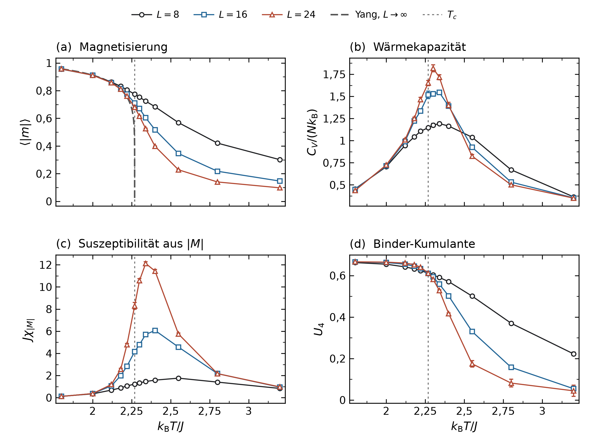

# Ising-Modell in zwei Dimensionen

Wie entsteht aus einer Wechselwirkung zwischen nächsten Nachbarn eine makroskopische Magnetisierung? Auf dem Quadratgitter lässt sich das direkt beobachten. Unterhalb der kritischen Temperatur dominiert eine Spinrichtung. In ihrer Nähe bilden sich zusammenhängende Bereiche auf vielen Längenskalen.

**[Browsersimulation herunterladen](https://github.com/chabane95/ising-modell-2d/raw/refs/heads/main/downloads/Ising-Modell-2D.zip)** · [Standbild](assets/domains.png) · [Messdaten](results/temperature_scan.csv)

ZIP entpacken und die HTML-Datei öffnen. Wer das Repository geklont hat, öffnet direkt [index.html](index.html). Die Simulation läuft offline. Beim Verschieben des Temperaturreglers entwickelt sich dasselbe Gitter weiter.

Drei unabhängige Gitter mit je 64 × 64 Spins bei $T=1{,}8$, $T_c$ und $T=3{,}2$. Nach dem Einschwingen zeigt die Animation 60 lokale Metropolis-Sweeps. Das Standbild hält Sweep 30 fest.

## Modell

Auf einem periodischen $L\times L$-Gitter trägt jeder der $N=L^2$ Plätze einen Spin $s_i=\pm1$. Gleich ausgerichtete Nachbarn senken bei $J>0$ die Energie. Das homogene Feld $h$ koppelt an die Gesamtmagnetisierung $M=\sum_i s_i$. Die Magnetisierung pro Spin ist $m=M/N$.

$$
E=-J\sum_{\langle i,j\rangle}s_i s_j-hM
$$

Jede Bindung geht einmal in die Summe ein. Für die Abbildungen gilt $J=k_\mathrm{B}=1$ und $h=0$. Das unendliche Quadratgitter hat bei $T_c=2/\ln(1+\sqrt 2)\simeq2{,}26919$ einen kontinuierlichen Phasenübergang. Auf dem endlichen Gitter sind beide Vorzeichen von $M$ im Nullfeld gleich wahrscheinlich. Als Ordnungsparameter verwende ich deshalb $\langle|M|\rangle/N$. [Onsager (1944)](https://doi.org/10.1103/PhysRev.65.117) · [Yang (1952)](https://doi.org/10.1103/PhysRev.85.808)

## Numerische Umsetzung

Im Browser läuft Metropolis. Ein Sweep besteht aus $N$ zufällig gewählten Einzelspin-Versuchen mit Zurücklegen. Für den Temperaturscan verwende ich im Nullfeld Wolff-Updates. Gleichgerichtete Nachbarn kommen mit Wahrscheinlichkeit $1-\exp(-2J/T)$ zum Cluster, der anschließend als Ganzes umklappt. Der Python-Code unterstützt auch Metropolis bei endlichem Feld. Ein Sweep zählt Monte-Carlo-Schritte und hat keine kalibrierte physikalische Dauer. [Metropolis et al. (1953)](https://doi.org/10.1063/1.1699114) · [Wolff (1989)](https://doi.org/10.1103/PhysRevLett.62.361)

Für jede Kombination aus drei Gittergrößen und zwölf Temperaturen laufen acht unabhängige Ketten. Je vier beginnen geordnet und zufällig. Nach 768 verworfenen Cluster-Updates folgen pro Kette 3072 Messungen, eine nach jedem Update. Die Fehlerbalken zeigen einen Standardfehler aus einem Jackknife über ganze Ketten. Die Tabelle enthält zusätzlich Autokorrelationszeiten für Energie und Magnetisierungsbetrag sowie den Energievergleich beider Startzustände. [Laufparameter](results/metadata.json)

Die Wärmekapazität pro Spin folgt aus $c_V=\mathrm{Var}(E)/(NT^2)$. Das Maximum von $\chi_{|M|}=\mathrm{Var}(|M|)/(NT)$ zeigt die stärksten Schwankungen des Ordnungsparameters. Die CSV enthält separat die lineare Suszeptibilität $\chi=\mathrm{Var}(M)/(NT)$. Die Binder-Kumulante $U_4=1-\langle M^4\rangle/(3\langle M^2\rangle^2)$ ist dimensionslos. Ihre Kurven treffen sich für diese Gittergrößen nahe $T_c$. [Vektorgrafik](assets/thermodynamics.svg)

## Zwei quantitative Prüfungen

- **Exakte Zustandssumme.** Auf dem $4\times4$-Gitter lassen sich alle 65 536 Zustände aufzählen. Bei $T=2{,}3$ ist $\langle E\rangle/N=-1{,}54131$. Metropolis liefert $-1{,}54289\pm0{,}00814$, Wolff $-1{,}53865\pm0{,}00514$. [Alle fünf Messgrößen](results/exact_check.csv)
- **Skalierung am kritischen Punkt.** Aus dem Verhältnis der Magnetisierungsbeträge bei $L=8$ und $24$ folgt $\beta/\nu=0{,}1191\pm0{,}0051$. Der exakte Wert ist $1/8$. Der angegebene Fehler erfasst die Monte-Carlo-Streuung. Die endlichen Gittergrößen verursachen eine zusätzliche systematische Abweichung. [Skalierungsdiagramm](assets/scaling.png) · [SVG](assets/scaling.svg)

## Selbst rechnen

Python ab 3.10. Für eine einzelne Messung genügen NumPy und die Python-Standardbibliothek.

~~~
python -m pip install -r requirements.txt
python main.py --size 16 --temperature 2.3
python main.py --size 16 --temperature 2.3 --field 0.1
~~~

Den veröffentlichten Scan, den exakten Vergleich und die Abbildungen erzeugen diese Befehle. Die Zahl der parallelen Prozesse lässt sich mit `--workers` anpassen.

~~~
python -m pip install -r requirements-plot.txt
python study.py --workers 4
python validate.py
python plot_results.py
python render_domains.py
~~~

Die Physik- und Statistiktests laufen mit `python -m unittest discover -s tests`, die Tests des Browserkerns mit `node --test tests/viewer.test.cjs`.
