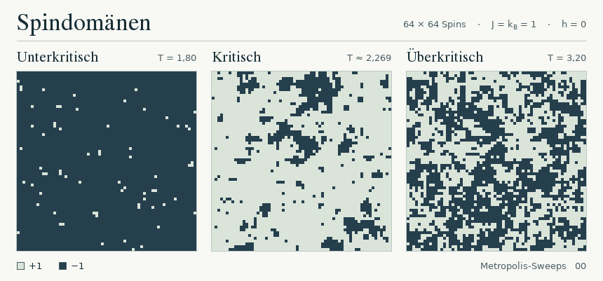
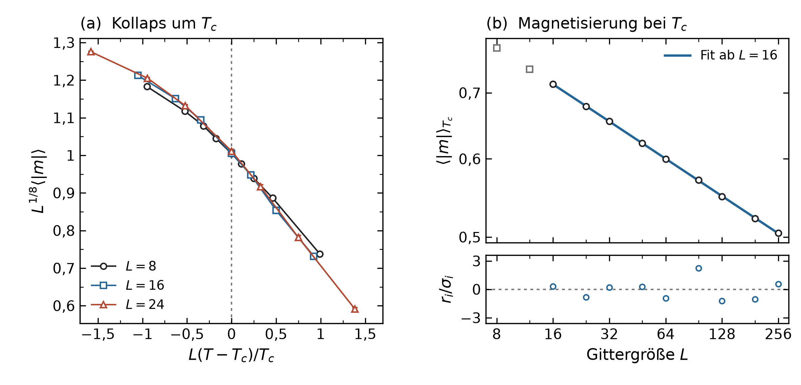
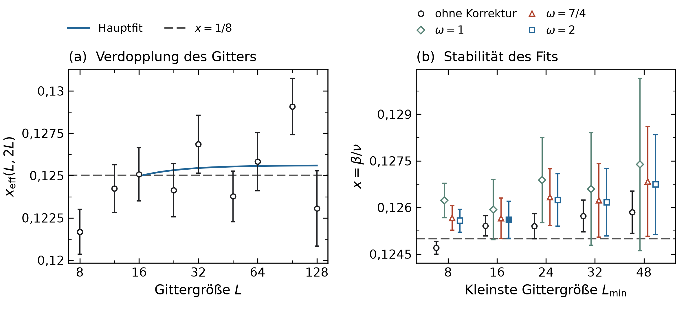

# Ising-Modell in zwei Dimensionen

Unterhalb der kritischen Temperatur dominiert auf dem Quadratgitter eine Spinrichtung. In der Nähe von $T_c$ entstehen Domänen auf ganz unterschiedlichen Längenskalen. Mich interessiert hier, wie sich das in der Magnetisierung eines endlichen Gitters messen lässt.

**[Simulation für den Browser herunterladen](https://github.com/chabane95/ising-modell-2d/raw/refs/heads/main/downloads/Ising-Modell-2D.zip)** · [Standbild](assets/domains.png) · [Messdaten](results/)

ZIP entpacken und die HTML-Datei öffnen. Nach dem Klonen genügt ein Doppelklick auf [index.html](index.html). Der Temperaturregler wirkt auf das laufende Gitter.

Von links nach rechts steigt die Temperatur. Alle drei Gitter haben $64^2$ Spins. Die Animation zeigt 60 lokale Metropolis-Sweeps nach dem Einschwingen.

## Modell und Messung

Jeder Platz trägt einen Spin $s_i=\pm1$. Die Ränder sind periodisch, jede Bindung zählt einmal.

$$
E=-J\sum_{\langle i,j\rangle}s_i s_j-h\sum_i s_i,\qquad m=L^{-2}\sum_i s_i .
$$

Für die Abbildungen gilt $J=k_\mathrm{B}=1$ und $h=0$. Damit liegt der kritische Punkt des unendlichen Quadratgitters bei $T_c=2/\ln(1+\sqrt{2})$. Auf einem endlichen Gitter sind beide Vorzeichen der Magnetisierung gleich wahrscheinlich. Ich messe deshalb den Betrag $\langle|m|\rangle$. [Onsager (1944)](https://doi.org/10.1103/PhysRev.65.117) · [Yang (1952)](https://doi.org/10.1103/PhysRev.85.808)

Im Browser besteht ein Metropolis-Sweep aus $L^2$ zufälligen Einzelspin-Versuchen. Für die Gleichgewichtsmessungen bei $T_c$ klappe ich mit dem Wolff-Verfahren ganze Cluster um und speichere nach jedem Update Energie und Magnetisierung. Die Zeitskala der Animation zählt Sweeps. [Metropolis et al. (1953)](https://doi.org/10.1063/1.1699114) · [Wolff (1989)](https://doi.org/10.1103/PhysRevLett.62.361)

## Der magnetische Exponent

Am kritischen Punkt fällt $\langle|m|\rangle$ mit der Gitterlänge wie $L^{-x}$. Die Messung bestimmt $x=\beta/\nu$. Mit dem bekannten $\nu=1$ entspricht der Zahlenwert auch $\beta$. Der Hauptfit beginnt bei $L=16$ und reicht bis $L=256$. Mit $r=L/16$ lautet der Ansatz

$$
\langle |m|\rangle_L=A\,r^{-x}(1+b\,r^{-\omega}).
$$

$A$, $b$ und $x$ sind frei. Für den Hauptfit habe ich vor der Auswertung $\omega=2$ festgelegt. Der Literaturwert $x=1/8$ geht nur als Vergleichslinie in die Fitdiagnostik ein. [Skalierung der Magnetisierungsverteilung](https://www2.icp.uni-stuttgart.de/~hilfer/publikationen/html/PRE-2003-68-046123/PRE-2003-68-046123.S2.html)

| Messung | Ausgewertete Größen | $\beta/\nu$ ± statistischer Standardfehler |
| --- | --- | --- |
| Früherer Zweipunktvergleich | 8 und 24 | 0,1191 ± 0,0051 |
| Hauptfit | 9 Größen von 16 bis 256 | **0,12560 ± 0,00060** |
| [Unabhängiger Kontrolllauf](results/repeat/critical_fit.json) | dieselben 9 Größen, doppelte Einlaufzeit | 0,12534 ± 0,00060 |

Links verwendet der Kurvenkollaps die bekannten Exponenten. Rechts stehen die unabhängigen Messungen direkt bei $T_c$. Die Quadrate bei $L=8$ und $12$ liegen außerhalb des Hauptfits. Darunter ist die Differenz zwischen Messung und Fit in Einheiten des jeweiligen Standardfehlers aufgetragen. [SVG](assets/scaling.svg)

Pro Größe laufen 24 unabhängige Ketten, zwölf aus einem geordneten und zwölf aus einem zufälligen Zustand. Nach 8192 verworfenen Cluster-Updates folgen je 32 768 Messungen. Für die Unsicherheit ziehe ich ganze Ketten innerhalb jeder Größe und Startart neu. Aus 4096 Bootstrap-Stichproben ergibt sich für $x$ ein 95-%-Intervall **von 0,12447 bis 0,12681**. Der Hauptfit ergibt $\chi^2=9{,}63$ bei sechs Freiheitsgraden. Der am Fitmodell zentrierte Bootstrap liefert $p=0{,}19$. [Replikamittel](results/critical_replicas.csv) · [Fit und Bootstrap](results/critical_fit.json)

Bei festem $L_\min=16$ liefern eine reine Potenz und die Ansätze mit $\omega=1$, $7/4$ und $2$ Werte von 0,12541 bis 0,12593. Beginnt der Hauptansatz erst bei $L=48$, ergibt sich $0{,}12674\pm0{,}00161$. Für die Korrekturamplitude ergibt sich $b=-0{,}00059\pm0{,}00153$. Selbst ihr Vorzeichen ist damit offen. Die Fehlerbalken zeigen die Monte-Carlo-Streuung innerhalb des jeweiligen Modells. [SVG](assets/critical_fit.svg) · [Finite-Size-Korrekturen auf dem Torus](https://arxiv.org/abs/cond-mat/9904038)

## Kontrollen

- **Startzustand.** Bei $L=96$ unterscheiden sich die Magnetisierungsbeträge aus geordneten und zufälligen Starts im ersten Lauf um 2,86 Standardfehler. Deshalb habe ich alle elf Größen mit neuem Seed und 16 384 verworfenen Updates wiederholt. Bei $L=96$ beträgt der Unterschied im Kontrolllauf −0,91 Standardfehler (zufälliger minus geordneter Start). [Erster Lauf](results/critical_diagnostics.csv) · [Kontrolllauf](results/repeat/critical_diagnostics.csv)
- **Energie auf endlichen Gittern.** Bei $L=256$ messe ich $E/N=-1{,}416670\pm0{,}000084$. Die exakte Zustandssumme desselben Torus ergibt $-1{,}416645$. Über alle elf Größen beträgt die größte Abweichung 1,61 Standardfehler. Auf dem $4\times4$-Gitter lassen sich außerdem alle 65 536 Zustände einzeln auszählen. [Exakte Energien](results/critical_energy_check.csv) · [4×4-Vergleich](results/exact_check.csv) · [Ferdinand und Fisher (1969)](https://doi.org/10.1103/PhysRev.185.832) · [Salas (2001)](https://doi.org/10.1088/0305-4470/34/7/307)

Der separate [Temperaturscan](assets/thermodynamics.png) zeigt für $L=8,16,24$ auch Wärmekapazität und Binder-Kumulante. Die dort gezeichnete Größe $\chi_{|M|}=\mathrm{Var}(|M|)/(L^2 T)$ beschreibt die Schwankung des Betrags. Die lineare Suszeptibilität aus dem vorzeichenbehafteten $M$ steht separat in der [Tabelle](results/temperature_scan.csv).

## Nachrechnen

Die [Zeitreihen](results/series/) enthalten die ganzzahligen Gesamtwerte `E` und `M` als NumPy-Arrays. Eine Zeile entspricht einer Replik, eine Spalte einem gespeicherten Cluster-Update. Die [Zeitreihen des Kontrolllaufs](results/repeat/series/) liegen separat. Mit Python ab 3.10 lassen sich die Daten prüfen, der Fit wiederholen und die Abbildungen neu zeichnen.

~~~sh
python -m pip install -r requirements-plot.txt
python archive_series.py --verify
python scaling_fit.py
python plot_results.py
~~~

Für neue kritische Messreihen benötigt der C99-Kern GCC oder Clang. `--workers` steuert die Anzahl parallel laufender Ketten. Vollständig gespeicherte Ketten werden beim erneuten Aufruf wiederverwendet.

~~~sh
python critical_study.py --workers 8
python archive_series.py
python exact_torus.py
python critical_study.py --workers 8 --warmup 16384 --seed 19438151 --output results/repeat
python scaling_fit.py --input results/repeat/critical_replicas.csv --output results/repeat/critical_fit.json
python archive_series.py --results results/repeat
python exact_torus.py --input results/repeat/critical_diagnostics.csv --output results/repeat/critical_energy_check.csv
~~~

Eine einzelne Feldmessung startet mit `python main.py --size 16 --temperature 2.3 --field 0.1`. Den Temperaturscan erzeugt `python study.py --workers 4`, die Animation `python render_domains.py` und den 4×4-Vergleich `python validate.py`. Die Tests laufen mit `python -m unittest discover -s tests` und `node --test tests/viewer.test.cjs`.
